# 表情包工作台

一张角色图，一套会动的聊天表情。

## 能做什么

给一张卡通角色、吉祥物、写实宠物或 3D 渲染图，产出：

- 一张张独立的透明循环 GIF，可直接放进聊天
- 一个打包 ZIP
- 一段能直接播放的预览 MP4

数量、台词、风格都由你定：可以做"收到 / 好耶 / 抱抱 / 晚安"这种日常款，也可以做"上班专用 30 张"或"纯安慰向 16 张"。

写实人物、宠物照片、细腻插画默认导出 512 × 512 清晰版；明确要像素风时才走 320 × 320 像素模式。

## 案例展示

自己跑出来的成品，三套 27 张。下面都是真实导出的 GIF，点开看原尺寸。

### 白T少年 · 9 张 · 512 × 512

3D 渲染风角色，白 T + 黑短裤 + 冰咖啡，配像素风点缀。分「日常回应」和「情绪陪伴」两组。

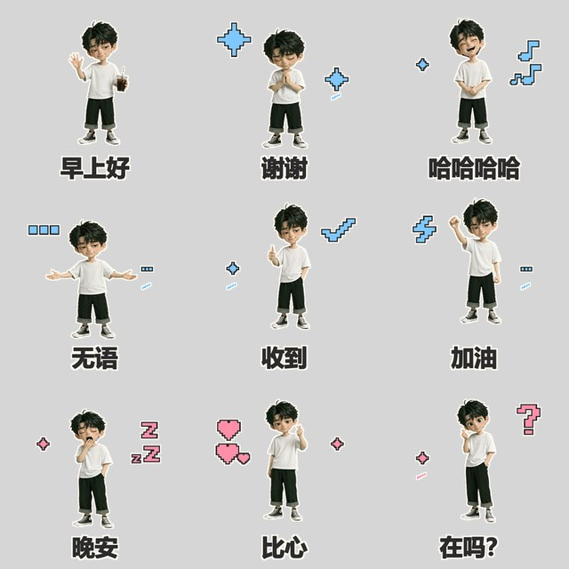

| | | |
| --- | --- | --- |
| <a href="examples/white-tee-boy/01-daily/001.gif">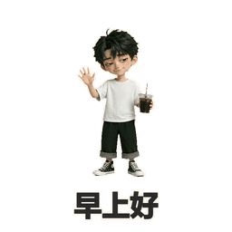</a><br>001 早上好 | <a href="examples/white-tee-boy/01-daily/002.gif">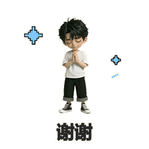</a><br>002 谢谢 | <a href="examples/white-tee-boy/01-daily/003.gif">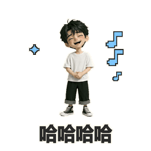</a><br>003 哈哈哈哈 |
| <a href="examples/white-tee-boy/01-daily/004.gif">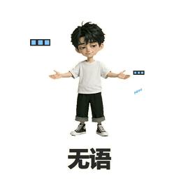</a><br>004 无语 | <a href="examples/white-tee-boy/01-daily/005.gif">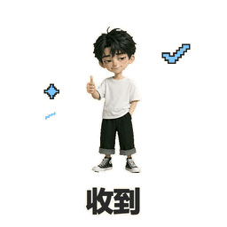</a><br>005 收到 | <a href="examples/white-tee-boy/01-daily/006.gif">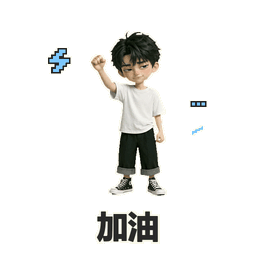</a><br>006 加油 |
| <a href="examples/white-tee-boy/02-companion/007.gif">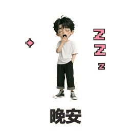</a><br>007 晚安 | <a href="examples/white-tee-boy/02-companion/008.gif">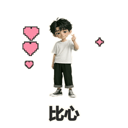</a><br>008 比心 | <a href="examples/white-tee-boy/02-companion/009.gif">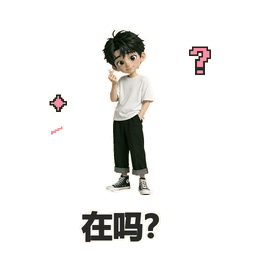</a><br>009 在吗？ |

### 慵懒少年 · 9 张 · 512 × 512

同一角色的第二套，台词更口语、更带情绪，动作幅度也更大。分「日常反应」和「情绪起伏」两组。

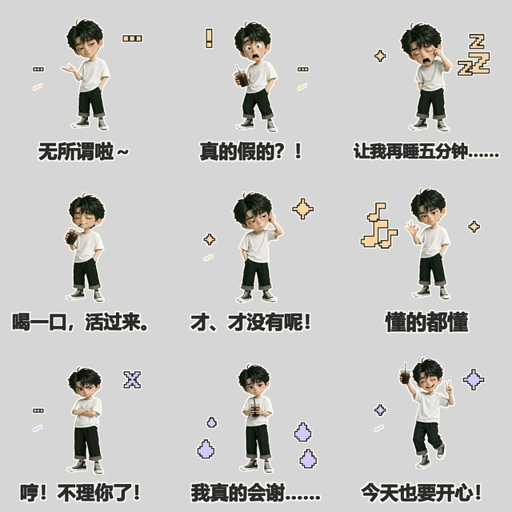

| | | |
| --- | --- | --- |
| <a href="examples/lazy-boy/01-daily/001.gif">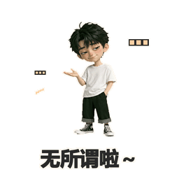</a><br>001 无所谓啦～ | <a href="examples/lazy-boy/01-daily/002.gif">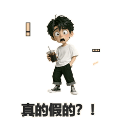</a><br>002 真的假的？！ | <a href="examples/lazy-boy/01-daily/003.gif">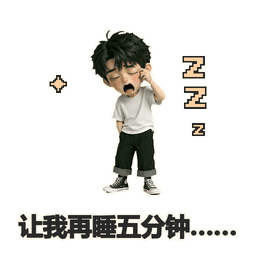</a><br>003 让我再睡五分钟…… |
| <a href="examples/lazy-boy/01-daily/004.gif">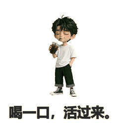</a><br>004 喝一口，活过来。 | <a href="examples/lazy-boy/01-daily/005.gif">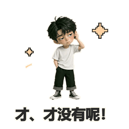</a><br>005 才、才没有呢！ | <a href="examples/lazy-boy/01-daily/006.gif">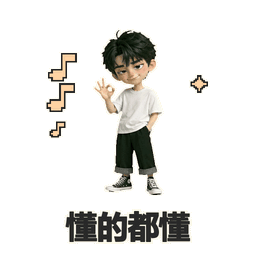</a><br>006 懂的都懂 |
| <a href="examples/lazy-boy/02-emotion/007.gif">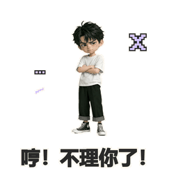</a><br>007 哼！不理你了！ | <a href="examples/lazy-boy/02-emotion/008.gif">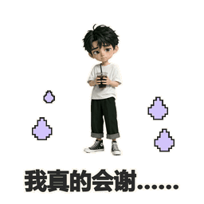</a><br>008 我真的会谢…… | <a href="examples/lazy-boy/02-emotion/009.gif">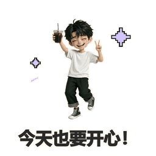</a><br>009 今天也要开心！ |

### 慵懒少年 · 关键帧版 · 9 张 · 512 × 512

同一批台词，换成**关键帧流程**重做：每张由 6 个生成姿势串联而成，手臂和手是真的在动，不是整张图做形变。单张约 1.1–1.3 秒。

对比着看就能看出两种做法的差别：上面那套是位移+挤压+摇摆，这套是关节动作。

| | | |
| --- | --- | --- |
| <a href="examples/lazy-boy-keyframes/01-daily/001.gif">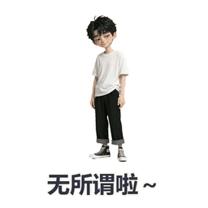</a><br>001 无所谓啦～ | <a href="examples/lazy-boy-keyframes/01-daily/002.gif">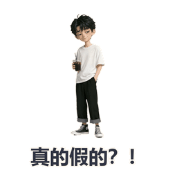</a><br>002 真的假的？！ | <a href="examples/lazy-boy-keyframes/01-daily/003.gif">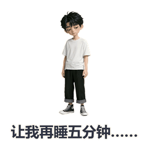</a><br>003 让我再睡五分钟…… |
| <a href="examples/lazy-boy-keyframes/01-daily/004.gif">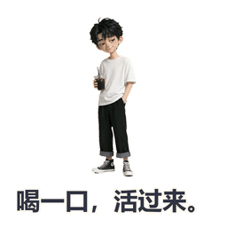</a><br>004 喝一口，活过来。 | <a href="examples/lazy-boy-keyframes/01-daily/005.gif">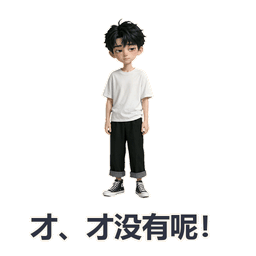</a><br>005 才、才没有呢！ | <a href="examples/lazy-boy-keyframes/01-daily/006.gif">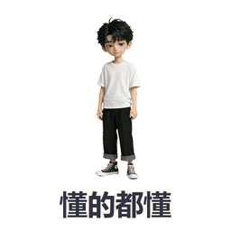</a><br>006 懂的都懂 |
| <a href="examples/lazy-boy-keyframes/02-emotion/007.gif">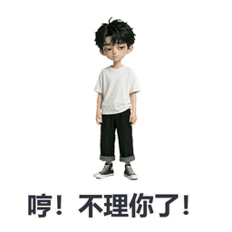</a><br>007 哼！不理你了！ | <a href="examples/lazy-boy-keyframes/02-emotion/008.gif">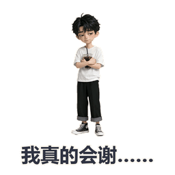</a><br>008 我真的会谢…… | <a href="examples/lazy-boy-keyframes/02-emotion/009.gif">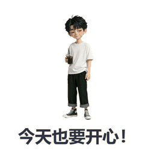</a><br>009 今天也要开心！ |

---

**这三套验证了四件事：**

1. **hd 默认值够用** —— 256 缩略图里发丝、衣服褶皱、冰咖啡的杯壁都还清楚，说明源分辨率没被浪费。
2. **透明背景是对的** —— 三个套包都是真 alpha 全零，不是白色底图假装透明。
3. **同角色能出第二套** —— 白T少年和慵懒少年共用同一个角色设定，台词和动作完全换新，没有语义重复。
4. **两种动效路线都通** —— 位移形变适合快速出量，关键帧适合"必须真的抬手"的动作。

> 展示图为 256 × 256 压缩版（保留透明通道），仓库里的成品是 512 × 512。角色为 AI 生成，台词为趣味二创。

## 怎么用

在能生成图片、能跑脚本的环境里调用本技能。

**第一步，给参考素材。** 一张角色图，最好背景干净、脸部清楚。3D 模型（GLB）也行，技能会先渲染一张正面或四分之三视角的参考。

**第二步，说清要什么。** 数量、台词、风格、用途，一次讲完最省事。例如：

> 用这张图里的角色做 16 张中文表情包，要"收到""好耶""抱抱""晚安"这类日常聊天用语，动作活泼一点，打包好，再给我一个能播放的预览。

没说清的地方技能会自己判断并说明，但台词和数量这类关键项，你直接给最准。

## 想要具体动作

挥手、点赞、比心、摊手这类会动到手臂和手的动作，技能会自动切到"连续姿势"流程：先生成几个动作阶段，固定人物位置后逐帧合成 GIF。这跟单张图的弹跳、摇摆、挤压是两种完全不同的做法。

这套方法适合小幅动作，可能有轻微跳帧或细节变化，不等同于视频模型生成的连续运动。详见[关节动作说明](references/keyframes.md)。

## 脸糊了怎么办

先说结论：**默认已经是清晰版了，不需要额外做什么。**

导出脚本会直接从原始素材合成 512 × 512，用平滑缩放和形变，预览视频默认不加标题。写实人物、宠物、细节插画用默认值就是对的。只有你明确要像素风，才需要切到像素模式。

如果出来的脸还是糊，八成是源图本身的分辨率不够——脸在源图里就只占了很少的像素。这种情况单纯放大补不回细节，得换一张更清楚的素材。判断方法和处理规则见[清晰度说明](references/clarity.md)。

## 自己跑脚本

需要 Python 3 + Pillow；要出预览 MP4 还需要带 libx264 的 FFmpeg。

准备一张透明背景的大图，把各个姿势分别放进等大的格子，再按[清单格式](references/manifest.md)填好每张的台词、格子和动效。

```sh
python3 -m pip install Pillow
python3 scripts/export_pack.py manifest.json build --font /path/to/font.ttf --preview
```

`--font` 后面填本机上一个支持中文的字体文件路径。成品会写进 `build` 目录。

- 默认导出 512 × 512 清晰版；要像素风就在命令里加 `--render-style pixel`。
- 默认动效包括位移、摇摆、挤压和移动点缀。
- 脚本会自查：数量、重复图、动效是否真的在动、背景是否透明、有没有裁掉内容、ZIP 能否正常打开。

需要"手臂真的抬起来"这种动作时，别用上面这个脚本，用关键帧那个：

```sh
python3 scripts/export_keyframes.py actions.json build --font /path/to/font.ttf --preview
```

## 目录

```
SKILL.md               主流程与验收标准
references/
  manifest.md          图集清单格式、动效预设、点缀列表
  keyframes.md         关节动作清单格式与做法
  clarity.md           清晰度诊断与高清合成参数
scripts/
  export_pack.py       单姿势图集导出（默认 hd 512）
  export_keyframes.py  多关键姿势合成导出
examples/
  white-tee-boy/       白T少年 9 张（256 压缩版，保留透明）
  lazy-boy/            慵懒少年 9 张（位移形变版）
  lazy-boy-keyframes/  慵懒少年 9 张（关键帧版）
```

## 许可

[MIT](LICENSE)
